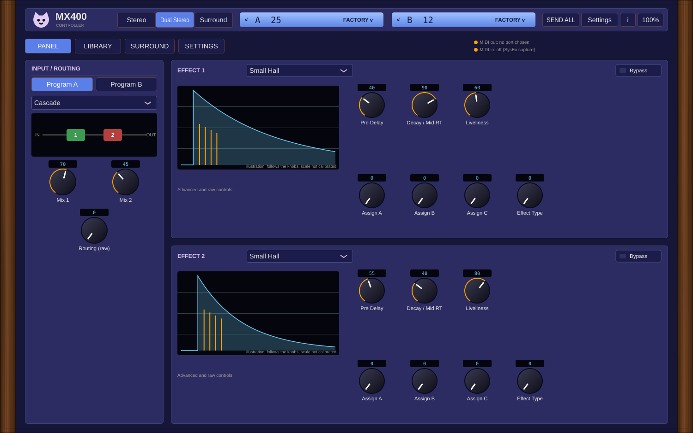

# MX400 VST for Linux 🐈

Free, open source MIDI controller plugin (VST3 and standalone) for the Lexicon MX400 hardware effects unit. It sends CC and program change from your DAW to the unit. It does not process audio, collects nothing and has no network code.

## Status
Version 0.1, early. Built and checked by tests (237 protocol checks, 33 processor checks), **not yet tested on a real MX400**.
- Built: Stereo, Dual Stereo and Surround CC maps from the manual, program change with bank select, A/B channels, direct MIDI port or host MIDI out, safe sending (nothing sent on project load, touched-only Send all, manual mode, rate limiting), program notes and favourites, SysEx capture and file check, resizable editor.
- Raw for now: effect type and routing values (the manual does not print the lists), bypass 127/0 by convention. Graphs are illustrations.
- Not built: surround trims, ducker, direct I/O, SysEx store, backup and restore (the MX-Edit SysEx format is undocumented; see [capture guide](docs/CAPTURE-GUIDE.md)).

## Download
See [Releases](../../releases). One zip per release: Windows and macOS installers, Linux Flatpak and .vst3, PDF manual.

## Install notes
- **Windows:** the installer is not signed yet, so SmartScreen may show "Windows protected your PC": click More info, then Run anyway. See the [code signing policy](docs/code-signing-policy.md).
- **macOS:** not signed or notarized by Apple (their program costs money; this project is free). macOS warns the first time; the easy fix is in [macOS install](docs/macos-install.md).
- **Linux:** Flatpak extension for Flatpak DAWs, or copy the .vst3 to `~/.vst3`. Details in INSTALL.txt inside the zip.

## Build
`cmake -S . -B build && cmake --build build` (needs a C++17 compiler; JUCE and cat-ui are fetched by CMake). Protocol tests without JUCE: `sh tests/run.sh`.

  

☕ Free and open source, made by one person. If it helps your music, a coffee on [Ko-fi](https://ko-fi.com/studio87) keeps it coming. 💜

## Docs
- [MIDI implementation](docs/MIDI-IMPLEMENTATION.md)
- [SysEx capture guide](docs/CAPTURE-GUIDE.md)
- [macOS install](docs/macos-install.md)
- [Code signing policy](docs/code-signing-policy.md)
- [Interactive mockups](docs/README.md)
- [Roadmap](ROADMAP.md)

## License
AGPL-3.0-or-later, see [LICENSE](LICENSE).

Not affiliated with or endorsed by any hardware maker named here. All trademarks belong to their owners.
